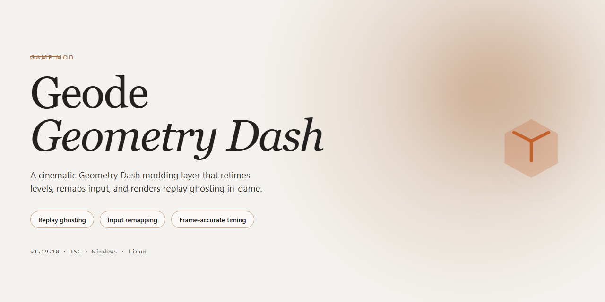

# 🧩 Geode Mod Loader — Build, Manage & Play Custom Geometry Dash Mods for Windows

### 💻 PowerShell Installer

  

---

Geode is the mod loader that turns Geometry Dash into a living, breathing platform—one where the community builds the content, and you decide how deep the rabbit hole goes. Whether you're here to tweak a single jump or overhaul the entire rhythm, this framework handles the install, the management, and the moment-to-moment play without getting in the way. It's built for modders and players alike: drop in your custom creations, browse what others have shared, and switch things up on the fly. No fuss, no fighting the game—just pure, customizable dash.

## ✅ Before You Start

- Windows 10 or Windows 11
- PowerShell 5.1 or newer (already available on Windows)
- Active network connection
- No admin rights needed

## Features

* **🔥 Mod loader at the core** — Geode slips into your Geometry Dash install and wakes up a full framework for custom content. Think of it as the engine room: it loads the mods, keeps them talking to the game, and stays out of your way while you play.

* **📚 A living mod index** — Browse, search, and pull in mods without ever leaving the game. The index is the beating heart of the whole setup, and it's built for exploration — stumble into something new, hit install, and jump straight back into a level.

* **🎛️ Toggles for days** — Every mod gets a switch. Flip them on and off mid-session, stack them, unstack them, and find the exact combination that makes the game feel like yours. No restarts, no drama.

* **⚡ Built for tinkerers** — Geode's framework gives mod authors real hooks into the game. If you've ever wanted to peek under the hood of Geometry Dash and bolt on your own ideas, this is the workbench you've been looking for.

* **🔄 Updates that keep pace** — Mod authors ship changes, and the loader keeps your library current. You'll know when something new lands, and applying it is a click, not a chore.

* **🧩 Plays nice with your setup** — Designed around the official Steam release of Geometry Dash, so it slots into the game you already own without rewriting your whole library.

* **🛠️ Modder-friendly from the ground up** — Whether you're installing your first mod or publishing your tenth, the framework is documented, approachable, and built by people who actually play the game. Break things, fix things, share things — that's the whole point.

* **🎮 Zero friction between you and the level** — Once it's running, the loader fades into the background. You play Geometry Dash. The mods just make it louder.

## Installation

Getting Geode onto your machine is the easy part — the real fun starts once the loader is live and your first mod is humming along. Here's how to go from a clean Geometry Dash install to a fully modded setup without tripping over the usual pitfalls.

**Before you touch anything:** shut Geometry Dash down completely. A running game holds file locks that will make the installer stumble. Confirm you're on the official Steam release of the game (the standalone builds and web ports don't play nice with the framework), and make sure you've got a couple hundred megabytes of breathing room on disk. Administrator rights on your account will save you a headache later.

### Laying the Foundation

Grab the official Geode installer from the project's releases — that's the only build you should trust for a clean first install. Once it's on your drive:

- Double-click the installer to wake the setup wizard.
- Point it at the folder holding your Geometry Dash executable. The installer is usually sharp enough to sniff out your Steam library on its own, but if it asks, steer it toward the directory containing the game binary.
- Let the wizard verify your game files — this is where it confirms your build is one it can work with.
- Hit install and let the progress bar do its thing. Don't interrupt it mid-flight.
- Finish up and close the wizard.

### First Contact

Fire up Geometry Dash through Steam as usual. If everything landed correctly, you'll spot a fresh Geode badge sitting on the main menu — that little icon is your doorway. Click it and the mod menu unfolds: a hub where you can browse the mod index, flip switches, and generally reshape the game to your liking.

Inside that menu you'll find the index browser. Search for whatever strikes your fancy, tap install, and Geode handles the rest — fetching, unpacking, and wiring the mod in automatically. Toggles let you enable or disable mods on the fly, and most changes take effect without a restart. When a developer ships an update, the menu nudges you and a single click refreshes the mod to its latest version.

### When Things Go Sideways

Mod loaders occasionally spook antivirus software. If the game refuses to launch after setup, add an exclusion for your Geometry Dash folder in your security suite and try again.

Mods not showing up? Nine times out of ten it's a game version mismatch — Geode expects the official Steam build. If performance takes a nosedive, work backward through your recently added mods, disabling them one at a time until the culprit reveals itself. And for stubborn startup crashes, the Geode settings panel has a cache-clearing option that resolves more problems than it has any right to.

One last thing worth saying plainly: keep your modding taste considerate. Visual tweaks and quality-of-life additions keep the online experience pleasant for everyone; gameplay-altering mods are a fast track to awkward territory with other players. Mod boldly, but mod kindly.

## Compatibility

Geode is built to live in harmony with the game you already know and love, but every setup has its own quirks. Here's what to keep in mind before you start stacking mods.

**The official Steam release is your home base.** Geode is engineered to hook into the Steam version of Geometry Dash. If your copy comes from somewhere else, the loader may not find what it's looking for, and mods won't show up in the panel. Stick with the official build and everything clicks into place.

**One loader, no leftovers.** Geode doesn't shred your game files to pieces. It layers itself over the existing installation, which means you can pull it out cleanly whenever you want and return to a vanilla game. Keep your original files intact and you'll always have a way back.

**Give it room to breathe.** Mods are guests in your game's memory — some are lightweight visual tweaks, others are heavy hitters that rewire gameplay logic. If you're running a big pile of them and notice the frame rate wobbling, switch mods off one at a time in the panel to find the culprit. Most conflicts are just two mods fighting over the same feature, not a broken loader.

**Play nice with your antivirus.** Security software occasionally gets suspicious of anything that reaches into a game executable. If Geometry Dash refuses to start after setup, add the game folder to your antivirus exclusions — nine times out of ten, that's the whole story.

**Updates move fast in this scene.** Mod authors ship fixes constantly, and Geode's panel flags them for you. Keep the loader and your favorite mods current — running an outdated mod against a fresh game version is the most common source of crashes and weird menu behavior.

**Respect the online playground.** Cosmetic and quality-of-life mods are generally safe territory. Mods that alter gameplay or difficulty can rub other players the wrong way in online spaces, so think twice before taking them into shared lobbies. Play smart and the community stays welcoming.

**Private servers and community projects** each have their own compatibility notes. Check what a given server expects before assuming a mod will slot in — some rely on specific supporting mods to function properly.

## Credits

Every mod loader is only as good as the community that builds around it, and this one stands on the shoulders of some seriously dedicated folks. Huge thanks to the Geode team for crafting a framework that makes tinkering with Geometry Dash feel less like surgery and more like play — the hooks, the event system, the whole architecture is a gift to anyone who's ever wanted to bend the game to their will.

To the modders out there pushing out quality-of-life tweaks, wild gameplay overhauls, and the kind of visual flourishes that make a level feel brand new — you're the reason this thing stays exciting. Every update, every bugfix, every late-night commit gets noticed. Keep shipping.

A nod to the testers and early adopters who poked at builds, reported crashes, and patiently explained what broke and where. Your eyes and patience turn rough ideas into something actually playable.

And of course, respect to RobTop for building the game we all can't stop modding. Without that foundation, none of this exists.

If you've contributed code, an idea, a bug report, or just a kind word in the community — consider yourself part of the crew. This project is better with you in it.

## License

This mod is released under the MIT License — the modder's handshake. It means you're free to use, copy, modify, merge, publish, distribute, sublicense, and sell copies of the mod and its source, so long as the original copyright notice and this permission notice travel with every copy or substantial portion of the work. Fork it, remix it, fold it into your own Geode project, ship it to your friends — the door is open.

The software is provided "as is," without warranty of any kind, express or implied, including but not limited to the warranties of merchantability, fitness for a particular purpose, and noninfringement. In no event shall the authors or copyright holders be liable for any claim, damages, or other liability — whether in an action of contract, tort, or otherwise — arising from, out of, or in connection with the software or its use. In plain terms: if a rogue mod crashes your run mid-attempt, that's on the modding frontier, not the license.

One courtesy among fellow modders: keep the copyright notice and this permission text intact in copies and substantial portions of the work. Credit is the currency of this community — a nod in your readme, a line in your source header, and everyone keeps building. Respect the original author's work, and the next modder will respect yours.